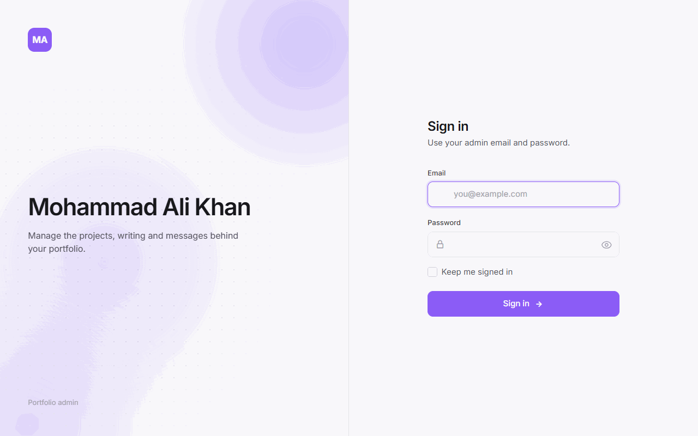

# Personal Portfolio — Laravel Backend 

Admin panel and REST API for a personal portfolio website. Manage your profile, projects, blog, skills, experience and more from the admin panel; a frontend (built with Next.js) reads everything through the `/api/v1` JSON API.

**Frontend:** coming soon

## Admin panel preview



Sign in, dashboard, projects (with row actions), blog posts, skills, experience, contact messages and settings. Visitor names, emails and message text are blurred.

## Features

- **Admin panel** (Bootstrap): profile, projects, blog posts, categories, skills, services, experience, education, training, certifications, testimonials, team, media, contact messages, newsletter subscribers (Excel export), settings, analytics
- **REST API** (`/api/v1`): read-only portfolio data plus contact form and newsletter endpoints
- Rate limiting (60 requests/minute), filtering, search and pagination on the API
- Postman collection included: [`docs/portfolio-api-postman-collection.json`](docs/portfolio-api-postman-collection.json)

## Requirements

- PHP 8.3+
- Composer 2
- Node.js 20.19+ and npm
- SQLite (default) or MySQL

## Installation

```bash
git clone https://github.com/makgr/personalportfolio.git
cd personalportfolio

composer install
npm install && npm run build

cp .env.example .env
php artisan key:generate

php artisan migrate --seed
php artisan storage:link

php artisan serve
```

Open http://localhost:8000/login and sign in with the seeded account:

- **Email:** `test@example.com`
- **Password:** `password`

Change this password right after your first login.

To use MySQL instead of SQLite, set `DB_CONNECTION=mysql` and the `DB_*` values in `.env` before running `migrate`.

## API

Base URL: `http://localhost:8000/api/v1`

| Method | Endpoint                                                       |
| ------ | -------------------------------------------------------------- |
| GET    | `/profile`                                                     |
| GET    | `/projects`, `/projects/featured`, `/projects/{slug}`          |
| GET    | `/blog-posts`, `/blog-posts/featured`, `/blog-posts/{slug}`    |
| GET    | `/categories`, `/categories/type/{type}`, `/categories/{slug}` |
| GET    | `/skills`                                                      |
| GET    | `/services`                                                    |
| GET    | `/experiences`                                                 |
| GET    | `/education`                                                   |
| GET    | `/training`, `/training/featured`                              |
| GET    | `/testimonials`, `/testimonials/featured`                      |
| GET    | `/teams`, `/teams/featured`, `/teams/{slug}`                   |
| GET    | `/settings`, `/settings/{key}`                                 |
| POST   | `/contact`                                                     |
| POST   | `/newsletter/subscribe`, `/newsletter/unsubscribe`             |

Every response has the shape:

```json
{ "success": true, "data": [], "message": "..." }
```

Import the Postman collection to try every endpoint with example parameters. Its `base_url` variable defaults to `http://localhost:8000`.

## Testing

```bash
php artisan test
```

## Contributing

Issues and pull requests are welcome. Please open an issue first for larger changes.

## Feature Requests & Custom Work

Want a new feature? [Open an issue](https://github.com/makgr/personalportfolio/issues) describing what you need.

Need something built or customized for your own portfolio or project? We're happy to do it — get in touch through any of the channels below.

## Support the Project

If this project helps you, you can sponsor or donate to support its development.

- **GitHub Sponsors:** [github.com/sponsors/makgr](https://github.com/sponsors/makgr)
- **Bank transfer:**

|              |                       |
| ------------ | --------------------- |
| Account Name | MOHAMMAD ALI KHAN     |
| Account No   | 2061510357001         |
| Bank         | Dutch Bangla Bank PLC |
| Branch       | Jamalpur              |
| SWIFT        | DBBLBDDH              |
| Routing No   | 090390854             |
| Country      | Bangladesh            |

For other ways to donate, contact us by email or Discord.

## Contact

- **Email:** [xvirus.bd@gmail.com](mailto:xvirus.bd@gmail.com)
- **Discord:** `semakgr`
- **Facebook:** [facebook.com/robotbalok](https://www.facebook.com/robotbalok)

## License

[MIT](LICENSE)
